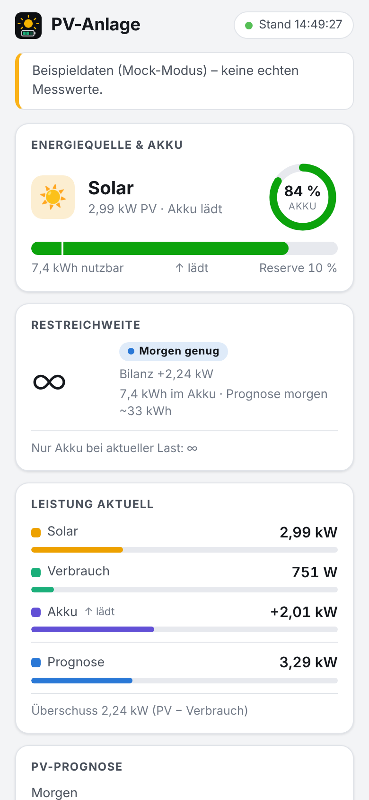
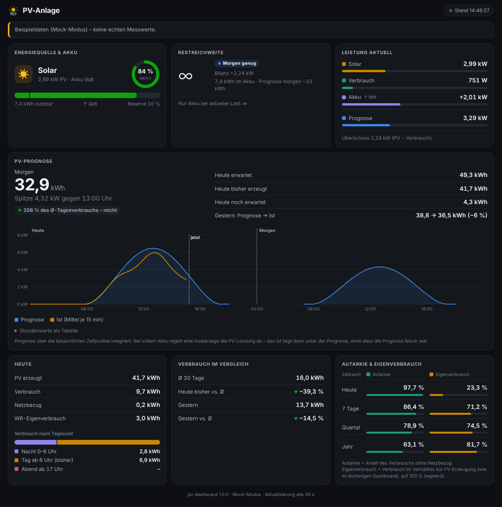

# pv-dashboard

Übersicht für PV-/Akku-Anlagen – Inselanlage oder netzgekoppelt. Ein kleiner Node.js-Dienst liest die Messwerte aus InfluxDB 1.x, berechnet Reichweite, Tageswerte und Autarkie und stellt alles bereit als

- **Web-App (PWA)** – installierbar „Zum Home-Bildschirm“, Vollbild, offline-fähige Hülle, Hell/Dunkel nach System
- **Desktop-/Tablet-Ansicht** derselben Oberfläche mit allen Kennzahlen
- **JSON-API** `GET /api/pv`
- **SolarDaily** (optional): Tages- und Gesamtzähler in kWh, direkt aus den Momentanleistungen per MQTT oder InfluxDB

Einzige Laufzeit-Abhängigkeit ist `mqtt` (nur für SolarDaily per MQTT). Die Oberfläche nutzt System-Schriften und lädt nichts von fremden Hosts.

<p>
  
  
</p>

*Screenshots mit erfundenen Beispieldaten (`--mock`).*

## Inhalt

- [Schnellstart](#schnellstart)
- [Konfiguration](#konfiguration)
- [Oberfläche](#oberfläche)
- [API und Datenmodell](#api-und-datenmodell)
- [Berechnungen](#berechnungen)
- [SolarDaily](#solardaily)
- [Betrieb](#betrieb)
- [Migration vom Node-RED-Flow](#migration-vom-node-red-flow)
- [Entwicklung](#entwicklung)

## Schnellstart

Voraussetzung: Node.js ≥ 20.

```sh
git clone <repo-url> pv-dashboard
cd pv-dashboard
npm ci

# Ausprobieren ohne InfluxDB (erfundene Beispieldaten):
node main.js --mock          # -> http://localhost:8080/

# Echter Betrieb:
cp config.example.js config.js   # Zugangsdaten, Measurement-Namen, Akku anpassen
node main.js
```

Auf dem Handy die Seite öffnen und „Zum Home-Bildschirm“ wählen (Android/Chrome: „App installieren“). Hinweis: Browser installieren PWAs und registrieren Service Worker nur in einem sicheren Kontext – über `https://` oder `localhost`. Im Heimnetz per `http://<host>:8080` funktioniert die Seite, die Installation als App braucht aber HTTPS, z. B. über einen Reverse-Proxy.

## Konfiguration

`config.js` (Vorlage: [`config.example.js`](config.example.js), alle Werte dort sind Platzhalter). Nicht gesetzte Schlüssel übernehmen die Defaults aus `lib/config.js`; eine optionale `config.local.json` überschreibt `config.js`. Zuletzt wird die Umgebungsvariable `CONFIG_JSON` (JSON mit denselben Schlüsseln) darübergelegt; ist sie gesetzt, darf `config.js` fehlen – praktisch für Container ohne eingebundene Datei. Beim Start wird die Konfiguration geprüft, Fehler werden mit Klartext gemeldet.

| Schlüssel | Bedeutung | Default |
|---|---|---|
| `port` | HTTP-Port (Umgebungsvariable `PORT` hat Vorrang) | `8080` |
| `dataDir` | Verzeichnis für `solardaily-state.json` (`DATA_DIR` hat Vorrang) | Programmverzeichnis |
| `timezone` | Zeitzone für Tagesgrenzen, Ankerzeiten, Quartal, Jahr | `Europe/Berlin` |
| `title` | Titel in der Oberfläche | `PV-Anlage` |
| `pollSeconds` | Abfrageintervall der Live-Werte | `30` |
| `aggregateMinutes` | Intervall für Woche/Quartal/Jahr | `30` |
| `forecastMinutes` | Intervall für die PV-Prognose | `5` |
| `battery.capacityKwh` | nutzbare Akku-Kapazität | `10` |
| `battery.minSoc` | Mindest-SOC (%) für die Restreichweite | `10` |
| `display.maxPvW` / `maxLoadW` / `maxBatW` | Skalenendwerte der Leistungsbalken (W) | `10000` / `10000` / `5000` |
| `influx.url`, `db`, `rp` | InfluxDB 1.x | – |
| `influx.username`, `password` | Basic-Auth (leer = ohne) | – |
| `influx.token` | statt Benutzer/Passwort: `Authorization: Token …` (2.x-Kompatibilitäts-API) | – |
| `measurements.soc/pv/load/battery` | Momentanwerte: SOC (%), PV, Last, Akku (W, Laden positiv) | – |
| `measurements.grid` | Netzleistung (W, Bezug positiv) – nur für SolarDaily mit `input: 'influx'` | – |
| `measurements.forecast` | PV-Prognose (W, Werte mit zukünftigen Zeitstempeln, beliebiges Raster) – optional | – |
| `measurements.daily.pv/load/grid/batIn/batOut` | Tageszähler in kWh (Reset 00:00) | – |
| `solardaily.*` | siehe [SolarDaily](#solardaily) | aus |

Je Messgröße wird ein Measurement mit Feld `value` erwartet (Schema des ioBroker-InfluxDB-Adapters). Ein kommentiertes Beispiel mit den ioBroker-/Solar-Assistant-Namen steht in `config.example.js`.

## Oberfläche

Eine Seite, die sich an die Bildschirmbreite anpasst: einspaltig auf dem Handy, zwei Spalten auf dem Tablet, drei auf dem Desktop.

- **Energiequelle & Akku** – Solar / Solar + Akku / Akku / Netz (Logik wie im bisherigen Widget), Ladezustand mit Reserve-Markierung, nutzbare kWh, Lade-/Entladerichtung
- **Restreichweite** – „smarte“ Reichweite (Akku + Prognose gegen Ø-Verbrauch) mit Status *Morgen genug / Ausreichend / Niedrig / Kritisch*, dazu die reine Akku-Reichweite bei aktueller Last
- **Leistung aktuell** – PV, Verbrauch, Akku, Prognose als Balken, Überschuss/Defizit
- **PV-Prognose** – Ertrag morgen mit Spitzenleistung und Anteil am Ø-Tagesverbrauch; heute erwartet, bisher erzeugt, noch erwartet; gestern Prognose gegen Ist; Diagramm heute + morgen (Prognose und gemessene Leistung, mit Fadenkreuz) und Stundentabelle
- **Heute** – PV, Verbrauch, Netzbezug, WR-Eigenverbrauch, Verbrauch nach Tageszeit (Nacht/Tag/Abend)
- **Verbrauch im Vergleich** – Ø 30 Tage, heute und gestern im Vergleich zum Ø
- **Autarkie & Eigenverbrauch** – heute, 7 Tage, Quartal, Jahr

Die Seite aktualisiert sich alle `pollSeconds`, pausiert im Hintergrund und zeigt ohne Verbindung den zuletzt geladenen Stand (deutlich als „Offline“ markiert). Der Service Worker hält nur die App-Hülle vor; API-Antworten werden nie aus dem Cache geliefert.

Statusfarben erscheinen immer zusammen mit Text oder Symbol. Die Datenfarben stammen aus einer auf Farbsehschwächen geprüften Palette, je eine Stufe für Hell und Dunkel.

## API und Datenmodell

| Pfad | Inhalt |
|---|---|
| `GET /api/pv` | aktuelle Kennzahlen (Felder unten). `503`, wenn seit 5 Zyklen keine Abfrage gelang |
| `GET /pv-data` | dasselbe unter dem Pfad des Node-RED-Flows (Übergangshilfe) |
| `GET /api/status` | Modus, letzte Aktualisierung, Fehler, SolarDaily-Zähler |
| `GET /api/meta` | Titel, Akku-Parameter, Balkenskalen, Intervall (ohne Zugangsdaten) |
| `GET /api/forecast` | Prognose- und Ist-Kurve heute 00:00 bis übermorgen 00:00 (`forecast`, `actual` als `[ms, W]`), Tagesgrenzen, Prognose-Kennzahlen. `404` ohne `measurements.forecast` |

`/api/pv` liefert dieselben Felder in derselben Reihenfolge wie bisher `/pv-data` (Beispiel: [`reference/sample/pv-data.example.json`](reference/sample/pv-data.example.json)), danach sechs Prognose-Ergänzungen. Fehlende Werte sind `null`. **Geänderte Bedeutung:** `forecast_tomorrow_kwh` ist jetzt der Kalendertag morgen (0–24 Uhr), nicht mehr die nächsten 24 h.

| Feld | Einheit | Bedeutung |
|---|---|---|
| `smart_range_label`, `smart_range_status` | – | Reichweite aus Akku + Prognose morgen gegen Ø-Verbrauch; Status `infinite`/`ok`/`warn`/`crit` |
| `forecast_tomorrow_kwh` | kWh | Prognose morgen 0–24 Uhr (lokal), über die Zeit integriert |
| `autarkie_heute`, `eigenverbrauch_heute` | % | Quoten aus den Tageszählern |
| `autarkie_woche`, `eigenverbrauch_woche` | % | letzte 7 Tage |
| `autarkie_season`, `eigenverbrauch_season` | % | seit Beginn des Kalenderquartals |
| `autarkie_jahr`, `eigenverbrauch_jahr` | % | seit 1. Januar |
| `wr_eigenverbrauch` | kWh | PV − Verbrauch − Akku geladen + \|Akku entladen\| (heute) |
| `ts` | ISO 8601 | Zeitpunkt der Berechnung |
| `soc` | % | Akku-Ladezustand |
| `avail_kwh` | kWh | (SOC − Mindest-SOC) × Kapazität |
| `pv_w`, `load_w`, `bat_w` | W | Momentanwerte (Akku: Laden positiv) |
| `bat_direction` | – | `charging` (> 50 W), `discharging` (< −50 W), sonst `idle` |
| `forecast_w` | W | letzter Prognosewert der vergangenen Stunde |
| `net_kw` | kW | PV − Verbrauch |
| `range_h`, `range_label`, `range_status` | h | Akku-Reichweite bei aktuellem Defizit, sonst `∞`/`infinite` |
| `daily_pv_kwh`, `daily_load_kwh`, `daily_grid_kwh` | kWh | Tageszähler |
| `avg_30d_kwh` | kWh | Ø der letzten 30 Tagesverbräuche > 1 kWh (inkl. heute) |
| `delta_pct` | % | heutiger Verbrauch gegen Ø 30 Tage |
| `kwh_nacht`, `kwh_tag`, `kwh_abend` | kWh | Verbrauch 0–6 Uhr, 6–17 Uhr, ab 17 Uhr |
| `yesterday_kwh`, `delta_yesterday_pct` | kWh, % | Verbrauch gestern und Abweichung zum Ø |
| `forecast_today_kwh` | kWh | Prognose heute 0–24 Uhr |
| `forecast_today_remaining_kwh` | kWh | Prognose von jetzt bis Mitternacht |
| `forecast_tomorrow_peak_w`, `forecast_tomorrow_peak_ts` | W, ISO 8601 | höchster Prognosewert morgen und Zeitpunkt |
| `forecast_yesterday_kwh`, `actual_yesterday_kwh` | kWh | Prognose für gestern und tatsächliche PV-Erzeugung gestern (Tageszähler) |

## Berechnungen

Die Formeln sind 1:1 aus der Node-RED-Function „Berechnen + JSON Response“ und den Quoten-Functions übernommen (`lib/metrics.js`, reine Funktionen mit Unit-Tests):

- **Reichweite:** `> 72 h` → ok, `≥ 8 h` ok, `≥ 3 h` warn, `≥ 1 h` crit, darunter Minuten, crit. Die smarte Reichweite ist `∞`, sobald Akku + Prognose den Ø-Tagesverbrauch decken.
- **Autarkie** = (Verbrauch − Netzbezug) / Verbrauch, **Eigenverbrauch** = Verbrauch / PV – jeweils auf 0–100 % begrenzt, 0,1 % gerundet. Fehlen Verbrauch oder PV (oder sind 0), ist die Quote `null`.
- **Woche:** Summe der letzten 7 Tageswerte (Verbrauch/PV > 1 kWh, Netz ≥ 0) aus den letzten 8 Tagen. **Quartal/Jahr:** alle Tageswerte ab Quartals- bzw. Jahresbeginn.
- **Nacht/Tag/Abend:** aus dem Verbrauchszähler um 06:00 und 17:00 (jeweils erster Wert im Fenster ± 15 min). Wie im Original gibt es den Tageswert erst ab 17 Uhr; die Oberfläche zeigt vorher den bisherigen Verbrauch seit 6 Uhr.
- **Gestern:** vorletzter Tageswert > 1 kWh der 32-Tage-Reihe (wie im Original – ist heute noch ≤ 1 kWh, ist das der Vorvortag).

- **PV-Prognose:** Die Prognosewerte werden über ihre Zeitstempel integriert (Trapez, an Tagesgrenzen linear interpoliert; Abschnitte über 2 h ohne Werte zählen nicht). Das ist unabhängig vom Raster des Prognosedienstes: Der ioBroker-Adapter *pvforecast* schreibt `summary.power` mit zukünftigen Zeitstempeln im Raster des Dienstes, z. B. stündlich, 30 min (Solcast) oder 15 min. Das Original rechnete `sum(value) / 1000`, das stimmt nur bei genau einem Wert pro Stunde und ergibt bei 30-min-Werten das Doppelte.

Abfragen: pro Zyklus **eine** Mehrfach-Query (Momentanwerte, Tageszähler, Prognose, 32-Tage-Reihe, Anker), alle `aggregateMinutes` **eine** weitere mit drei 366-Tage-Reihen für Woche/Quartal/Jahr, alle `forecastMinutes` **eine** für die Prognose (Rohwerte gestern bis übermorgen, PV-Leistung heute als 15-min-Mittel, PV-Erzeugung gestern). Tagesreihen nutzen `GROUP BY time(1d) … tz('<timezone>')`, die Tagesgrenze ist damit ganzjährig die lokale Mitternacht.

## SolarDaily

Ersetzt das ioBroker-Skript „SolarDaily v3“ (`lib/solardaily.js`). Es integriert die Momentanleistungen zu Energiemengen:

- **Zähler:** PV-Erzeugung, Verbrauch, Netzbezug, Akku geladen, Akku entladen – je als Tageswert (Reset 00:00 lokal) und Gesamtwert (ohne Reset).
- **Verfahren:** `rectangle` (Default, wie das Original): *neuer Wert × Zeit seit dem letzten Wert dieses Kanals*. Alternativ `trapezoid`: Mittel aus altem und neuem Wert × Zeit (genauer bei schwankender Leistung; bei Vorzeichenwechsel wird als Rechteck gerechnet, damit Laden/Entladen nicht vermischt werden).
- **Lücken:** Liegen mehr als `maxGapMinutes` (Default 5) zwischen zwei Werten, wird das Intervall verworfen; der Zeitstempel läuft trotzdem weiter.
- **Akku:** Leistung ≥ 0 zählt als geladen, < 0 als entladen. Wie im Original wird „entladen“ **negativ** aufsummiert (die Berechnung nutzt den Betrag). Meldet die Quelle Laden als negativ, `batteryChargePositive: false` setzen.
- **Netz:** nur Bezug (≥ 0) zählt, Einspeisung wird ignoriert.
- **Tageswechsel:** Der erste Wert nach Mitternacht zählt mit seinem ganzen Intervall zum neuen Tag (wie beim zeitgesteuerten Reset des Originals). Ein Zeitgeber setzt die Tageszähler auch ohne neue Werte um 00:00 zurück.
- **Zustand:** `solardaily-state.json` im `dataDir`, atomar geschrieben (temporäre Datei + Umbenennen), höchstens alle `saveIntervalMinutes` (Default 5), beim Tageswechsel und beim Beenden. Nach einem Neustart zählt der nächste Wert weiter, wenn die Lücke kleiner als `maxGapMinutes` ist.

**Eingang** (`solardaily.input`):

- `mqtt` – abonniert je Kanal ein Topic (`solardaily.mqtt.topics.pv/load/battery/grid`), Payload als Zahl oder JSON mit `value`. Bei Solar Assistant z. B. `solar_assistant/total/pv_power/state` – das Vorzeichen der Akkuleistung an der eigenen Anlage prüfen.
- `influx` – fragt `measurements.pv/load/battery/grid` alle `influxPollSeconds` ab und verarbeitet jeden Messpunkt einmal mit seinem eigenen Zeitstempel. Schreibt die Quelle nur bei Änderung, entstehen bei konstanter Leistung Lücken, die nach `maxGapMinutes` verworfen werden – MQTT ist genauer.

**Ist SolarDaily an**, kommen die Tageswerte für `/api/pv` aus dem Modul. Ø 30 Tage, Quoten und Nacht/Tag/Abend brauchen weiterhin die Tagesreihen in InfluxDB: dafür `solardaily.write.enabled: true` setzen und unter `write.measurements.daily` dieselben Namen wie in `measurements.daily` eintragen. Geschrieben wird je Zähler eine Zeile mit Feld `value` alle `write.intervalSeconds`.

**Ist SolarDaily aus**, kommen die Tageszähler aus InfluxDB (`measurements.daily`), z. B. weiter vom ioBroker-Skript.

## Betrieb

**Docker** (läuft als Benutzer `node`, Healthcheck auf `/api/pv`):

```sh
cp config.example.js config.js     # anpassen
docker compose up -d --build
```

`config.js` wird schreibgeschützt eingebunden, der Zustand liegt im Volume `/app/data`. Zum Ausprobieren ohne InfluxDB in `docker-compose.yml` die Zeile `command: ["node", "main.js", "--mock"]` aktivieren. Statt `config.js` einzubinden, kann die Konfiguration auch als `CONFIG_JSON` im `environment` stehen.

**systemd:** Unit in [`contrib/pv-dashboard.service`](contrib/pv-dashboard.service) (Installation unter `/opt/pv-dashboard`, eigener Benutzer `pv`, Schreibrechte nur im Programmverzeichnis).

```sh
systemctl status pv-dashboard
journalctl -u pv-dashboard -f
```

Die Oberfläche hat keine Anmeldung und keine schreibenden Endpunkte; sie zeigt aber Anlagendaten. Nur im vertrauenswürdigen Netz oder hinter einem Reverse-Proxy mit Authentifizierung betreiben.

## Migration vom Node-RED-Flow

Das bisherige Original (Node-RED-Tab, Widget, ioBroker-Skript) liegt unverändert unter [`reference/`](reference/).

1. `config.js` anlegen und das kommentierte ioBroker-Beispiel aus `config.example.js` übernehmen (Datenbank, Retention Policy, Measurement-Namen). Akku-Kapazität und Mindest-SOC eintragen.
2. Dienst starten, `/api/pv` mit der bisherigen `/pv-data`-Antwort vergleichen. Konsumenten können zunächst unverändert `/pv-data` nutzen.
3. Optional SolarDaily übernehmen: `solardaily.enabled: true`, Eingang `mqtt` mit den Solar-Assistant-Topics, `write.enabled: true` mit den bisherigen `javascript.0.SolarDaily.*`-Namen – dann das ioBroker-Skript stoppen (sonst zählen beide in dieselben Serien).
4. Node-RED-Tab und Widget abschalten.

**Bewusste Abweichungen vom Original:**

| Original | Neu | Grund |
|---|---|---|
| Ankerfenster und Tagesbuckets fest auf UTC+2 (`time(1d, 22h)`, 04:00/15:00 UTC) | Zeitzone aus der Konfiguration, `tz()` in InfluxQL | im Winter lagen Tagesgrenze und Anker um eine Stunde daneben |
| Quartal/Jahr ab `<Stichtag> 22:00 UTC` | ab lokalem Stichtag | der erste Tag des Quartals/Jahres fehlte |
| Quartalsbeginn nach UTC-Monat | nach lokalem Monat | Silvester/Quartalswechsel um Mitternacht lokal |
| 25 Einzelabfragen je Aufruf | 1 Mehrfach-Query je Zyklus + 1 alle 30 min | Last auf InfluxDB |
| Berechnung je HTTP-Aufruf | Berechnung je Zyklus, Antwort aus dem Speicher | beliebig viele Clients ohne Zusatzlast |
| Anker 22:00 abgefragt, aber nicht verwendet; Prognose-Summe doppelt abgefragt | entfällt | – |
| `forecast_tomorrow_kwh` = `sum(value)/1000` der nächsten 24 h | Kalendertag morgen 0–24 Uhr, über die Zeit integriert | richtig bei jedem Raster; „morgen“ heißt morgen. Die smarte Reichweite rechnet damit ebenfalls mit dem morgigen Tag |
| Widget-Beschriftung „Nacht 22–06“, „Abend 17–22“ | „Nacht 0–6 Uhr“, „Abend ab 17 Uhr“ | entspricht der tatsächlichen Berechnung (Zähler startet um 0 Uhr, Abend läuft bis jetzt) |
| Google Fonts | System-Schriften | keine externen Requests |

## Entwicklung

```sh
npm test                 # node --test: Berechnungen, SolarDaily, InfluxDB-Anbindung, Server
node main.js --mock      # Oberfläche mit erfundenen Daten
```

```
main.js              Einstieg (CLI, Signale)
lib/app.js           Verdrahtung: Zyklen, SolarDaily, Server
lib/config.js        Defaults, config.js + config.local.json + CONFIG_JSON, Prüfung
lib/metrics.js       Kennzahlen (Port der Node-RED-Functions)
lib/solardaily.js    Tages-/Gesamtzähler
lib/inputs.js        SolarDaily-Eingänge (MQTT, InfluxDB)
lib/source.js        InfluxQL-Abfragen
lib/influx.js        InfluxDB-1.x-HTTP-Client
lib/mock.js          erfundene Beispieldaten
lib/server.js        HTTP: API, statische Dateien, CSP
lib/time.js          Zeitzonen-Hilfen
web/                 PWA (index.html, app.js, app.css, sw.js, Manifest, Icons)
test/                Tests
contrib/             systemd-Unit
reference/           bisheriges Original (unverändert)
```

## Lizenz

[MIT](LICENSE)
